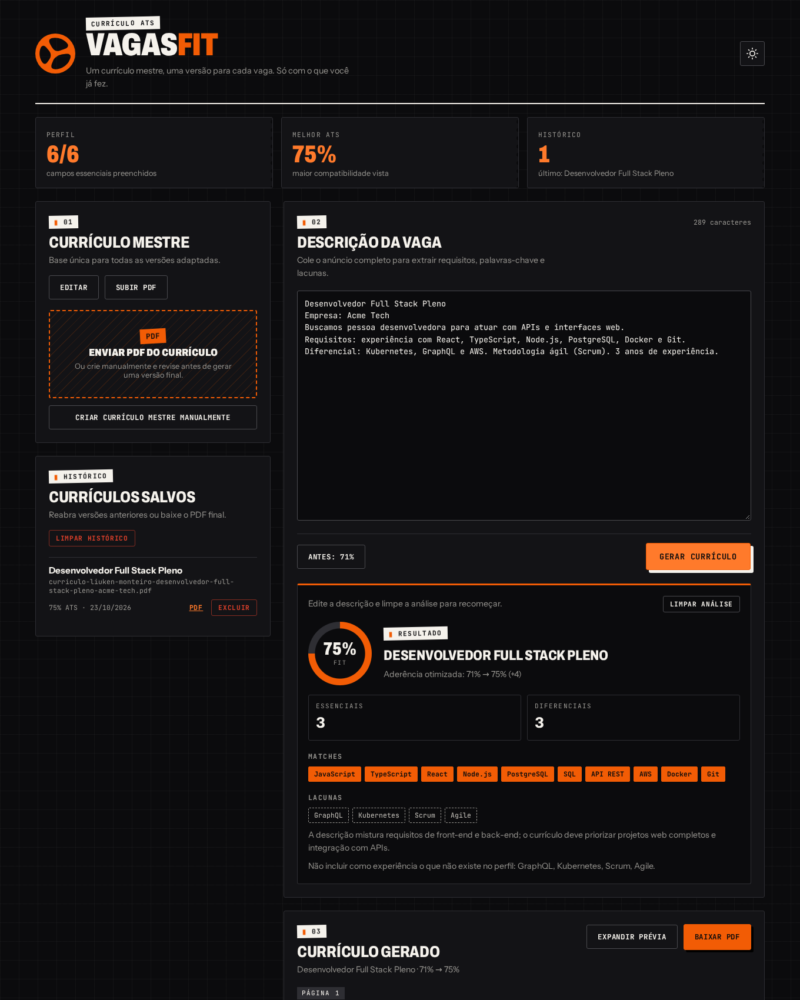

# VagasFit — currículo ATS sob medida para cada vaga

Você mantém **um currículo mestre** e o VagasFit gera uma versão adaptada a cada vaga de TI, com a descrição reescrita, as skills reordenadas e uma estimativa de aderência ao filtro ATS — **sem inventar experiência**. O que a vaga pede e o seu perfil não tem aparece como *lacuna*, nunca como afirmação no currículo.

O sistema guarda tudo em um banco **Firebird 5**, acessado em Python com o **[firebird-driver](https://github.com/FirebirdSQL/python3-driver)**: perfil mestre normalizado, histórico de currículos gerados e um relatório (view SQL) de desempenho por tipo de vaga.



## O que faz

- **Cadastro do perfil mestre**: envie seu currículo em PDF (o sistema lê e preenche) ou edite à mão — experiências, projetos, formação, grupos de skills e idiomas.
- **Análise da vaga**: cole o anúncio e veja foco (front, back, full stack, suporte, infra), senioridade, requisitos essenciais e diferenciais, *matches* e lacunas.
- **Geração do currículo**: título, resumo, descrições e skills são reordenados e reescritos a partir do que existe no perfil, com um *changelog* do que mudou e avisos de verdade.
- **Download em PDF** com nome automático: `curriculo-nome-da-pessoa-titulo-da-vaga-empresa.pdf`.
- **Histórico e relatório**: cada currículo gerado fica salvo; `GET /api/reports/resumes` devolve o ATS médio por foco de vaga, vindo de uma *view* do banco.

## Stack

| Camada | Tecnologia |
| --- | --- |
| Banco | **Firebird 5** (Docker), driver **firebird-driver** |
| API | Python 3.10+, FastAPI, Pydantic |
| PDF | PyMuPDF (ler o PDF do currículo) e Playwright/Chromium (gerar o PDF final) |
| Frontend | React + Vite + TypeScript |

```
Navegador (React) ──HTTP/JSON──▶ FastAPI ──firebird-driver──▶ Firebird 5
                                    │
                                    ├─ job_analyzer   → palavras-chave, foco, senioridade, lacunas
                                    ├─ resume_tailor  → versão do currículo para a vaga
                                    ├─ profile_parser → PDF do currículo → perfil
                                    └─ pdf_service    → HTML → PDF (Chromium)
```

## Como rodar

**Pré-requisitos:** Docker, Python 3.10+, Node 20+ e a biblioteca cliente do Firebird (`libfbclient`).

```bash
# Ubuntu/Debian: biblioteca cliente que o firebird-driver carrega
sudo apt install libfbclient2
```

> Sem `sudo`? Extraia a `libfbclient.so` da imagem do Docker para `apps/api/.fbclient/` e aponte `FIREBIRD_CLIENT_LIB` para ela no `.env`.

```bash
# 1. Variáveis de ambiente
cp .env.example .env

# 2. Sobe o servidor Firebird (cria o banco vagafit.fdb na primeira vez)
npm run db:up

# 3. Dependências do frontend e da API Python
npm install
npm run setup -w @vagafit/api      # venv + pip install + chromium do Playwright

# 4. Cria as tabelas (script abaixo)
npm run db:init

# 5. (opcional) importa o perfil/currículos da versão antiga em JSON
npm run db:import -w @vagafit/api

# 6. Sobe API (http://localhost:3333) e frontend (http://localhost:5173)
npm run dev
```

Testes: `npm test` (não precisam do banco).

## Script para criar o banco

O servidor do Docker já cria o arquivo `vagafit.fdb`. As tabelas vêm de [`apps/api/scripts/schema.sql`](apps/api/scripts/schema.sql), aplicado por `npm run db:init` (`python -m scripts.init_db`). O script é idempotente: se as tabelas já existem, ele avisa e não mexe em nada; `--reset` apaga e recria.

Trecho do esquema:

```sql
CREATE TABLE PROFILES (
    ID            VARCHAR(64)   NOT NULL,
    FULL_NAME     VARCHAR(200)  DEFAULT '' NOT NULL,
    TARGET_TITLE  VARCHAR(200)  DEFAULT '' NOT NULL,
    SUMMARY       BLOB SUB_TYPE TEXT,
    EMAIL         VARCHAR(200),
    /* ... telefone, linkedin, github, portfólio, local ... */
    CREATED_AT    TIMESTAMP     NOT NULL,
    UPDATED_AT    TIMESTAMP     NOT NULL,
    CONSTRAINT PK_PROFILES PRIMARY KEY (ID)
);

CREATE TABLE EXPERIENCES (
    ID           INTEGER GENERATED BY DEFAULT AS IDENTITY,
    PROFILE_ID   VARCHAR(64)  NOT NULL,
    SEQ          SMALLINT     NOT NULL,           -- ordem de exibição
    ROLE_TITLE   VARCHAR(300) NOT NULL,
    COMPANY      VARCHAR(300) NOT NULL,
    START_DATE   VARCHAR(30),
    END_DATE     VARCHAR(30),
    DESCRIPTION  BLOB SUB_TYPE TEXT,
    CONSTRAINT PK_EXPERIENCES PRIMARY KEY (ID),
    CONSTRAINT FK_EXPERIENCES_PROFILE FOREIGN KEY (PROFILE_ID)
        REFERENCES PROFILES (ID) ON DELETE CASCADE
);

CREATE TABLE TAILORED_RESUMES (
    ID            VARCHAR(36)  NOT NULL,
    PROFILE_ID    VARCHAR(64)  NOT NULL,
    JOB_TITLE     VARCHAR(300) NOT NULL,
    FOCUS         VARCHAR(20)  NOT NULL,
    ATS_BASELINE  SMALLINT     NOT NULL,
    ATS_SCORE     SMALLINT     NOT NULL,
    CREATED_AT    TIMESTAMP    NOT NULL,
    CONTENT       BLOB SUB_TYPE TEXT NOT NULL,    -- documento completo em JSON
    /* ... */
    CONSTRAINT CK_RESUMES_SCORE CHECK (ATS_SCORE BETWEEN 0 AND 100)
);

CREATE VIEW V_RESUME_REPORT AS
SELECT FOCUS,
       COUNT(*)                                       AS TOTAL,
       CAST(AVG(ATS_BASELINE * 1.0) AS NUMERIC(5,1))  AS AVG_BASELINE,
       CAST(AVG(ATS_SCORE * 1.0)    AS NUMERIC(5,1))  AS AVG_SCORE,
       MAX(ATS_SCORE)                                 AS BEST_SCORE,
       MAX(CREATED_AT)                                AS LAST_GENERATED
FROM TAILORED_RESUMES
GROUP BY FOCUS;
```

Modelo: `PROFILES` 1—N `EXPERIENCES`, `PROJECTS`, `EDUCATION`, `SKILL_GROUPS`, `LANGUAGES`; as skills ficam em tabelas-filhas (`EXPERIENCE_SKILLS`, `PROJECT_SKILLS`, `SKILL_GROUP_ITEMS`); `PROFILES` 1—N `TAILORED_RESUMES`. As chaves estrangeiras usam `ON DELETE CASCADE`.

## Consultas e relatório

Pelo `isql` do Firebird (ou qualquer cliente SQL), com alguns currículos gerados:

```sql
SELECT FOCUS, TOTAL, AVG_BASELINE, AVG_SCORE, BEST_SCORE FROM V_RESUME_REPORT ORDER BY TOTAL DESC;

FOCUS                  TOTAL AVG_BASELINE    AVG_SCORE BEST_SCORE
==================== ======= ============ ============ ==========
frontend                   2         33.5         37.5         75
infra                      1         78.0         79.0         79
backend                    1         11.0         26.0         26
fullstack                  1         69.0         73.0         73
```

Pela API: `GET /api/reports/resumes` devolve o mesmo resultado em JSON.

## Como o Python fala com o Firebird

O acesso ao banco está concentrado em dois arquivos pequenos:

- [`app/db.py`](apps/api/app/db.py) abre a conexão com `firebird.driver.connect(...)` e expõe `transaction()`, um *context manager* que faz `commit` ao sair e `rollback` em erro.
- [`app/storage.py`](apps/api/app/storage.py) tem todas as consultas, sempre parametrizadas (`?`), nunca com texto concatenado.

Recursos do Firebird usados de propósito:

- **`UPDATE OR INSERT ... MATCHING (ID)`** para salvar o perfil (o *upsert* nativo).
- **`INSERT ... RETURNING ID`** com colunas `GENERATED BY DEFAULT AS IDENTITY`, para ligar experiências às suas skills sem uma segunda consulta.
- **`ON DELETE CASCADE`**: salvar o perfil apaga e recria as tabelas-filhas dentro de **uma única transação**; se algo falhar no meio, nada muda.
- **`BLOB SUB_TYPE TEXT`** para textos longos e para o JSON do currículo gerado.
- **View** para o relatório, em vez de agregar em Python.

## Endpoints

| Método | Rota | O que faz |
| --- | --- | --- |
| GET / PUT | `/api/profile` | lê / salva o perfil mestre |
| POST | `/api/profile/from-pdf` | lê um PDF e preenche o perfil |
| POST | `/api/jobs/analyze` | analisa a descrição da vaga |
| POST | `/api/resumes/generate` | gera e salva o currículo da vaga |
| GET | `/api/resumes`, `/api/resumes/{id}` | histórico / um currículo |
| GET | `/api/resumes/{id}/pdf` | baixa o PDF |
| DELETE | `/api/resumes`, `/api/resumes/{id}` | limpa o histórico / apaga um |
| GET | `/api/reports/resumes` | relatório por foco de vaga (view) |

A documentação interativa fica em `http://localhost:3333/docs`.

## Estrutura

```
apps/
  api/
    app/
      main.py, config.py, db.py, storage.py, models.py
      routes/      profile · jobs · resumes · reports
      services/    job_analyzer · resume_tailor · profile_parser · resume_html · pdf_service
      utils/       text · slug
    scripts/       schema.sql · init_db.py · import_json.py
    tests/
  web/             React + Vite (identidade visual Liuken Monteiro)
docker-compose.yml  Firebird 5
```

## Regra de ouro

A plataforma pode reorganizar, reescrever e destacar informações **reais** do perfil. Ela não afirma experiência inexistente: tecnologias que aparecem na vaga e não aparecem no currículo mestre viram lacunas ou sugestões de estudo. Isso é testado em [`tests/test_resume_tailor.py`](apps/api/tests/test_resume_tailor.py).

## Histórico do projeto

A primeira versão tinha o backend em Node/Express com arquivos JSON. O backend foi portado para Python e o armazenamento migrou para o Firebird. A migração foi validada contra a versão antiga: as mesmas 5 descrições de vaga geram análises, currículos e HTML idênticos, e 30 PDFs reais produzem os mesmos perfis. O `git log` mostra cada etapa.

## Próximos passos

1. Editor do perfil com CRUD completo na interface.
2. Autenticação e múltiplos perfis (o esquema já separa por `PROFILE_ID`).
3. Análise por link de vaga.
4. Versão DOCX.
5. Extensão de Chrome para capturar vagas do LinkedIn, Gupy e Indeed.
